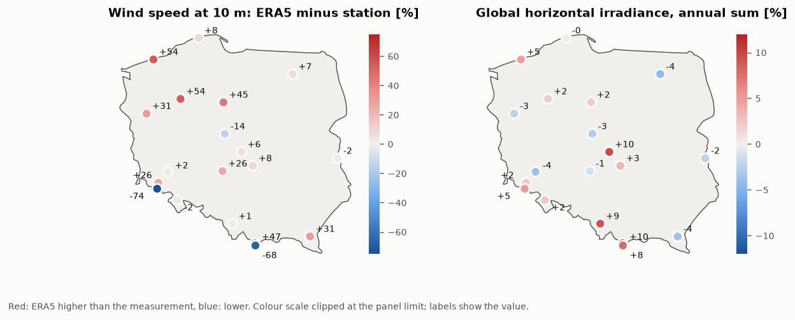
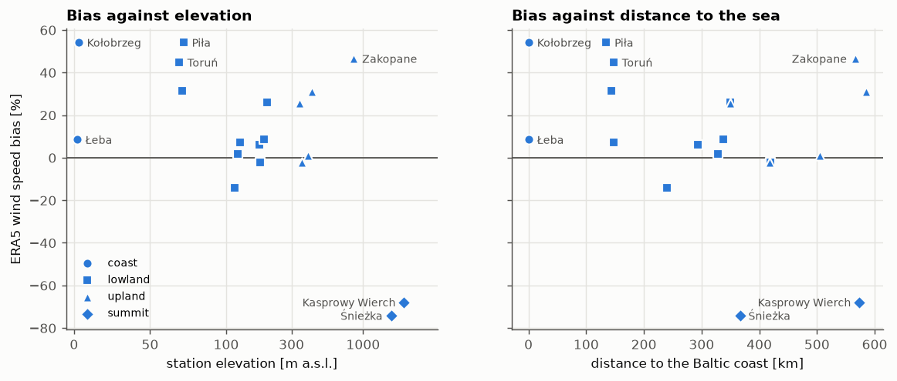
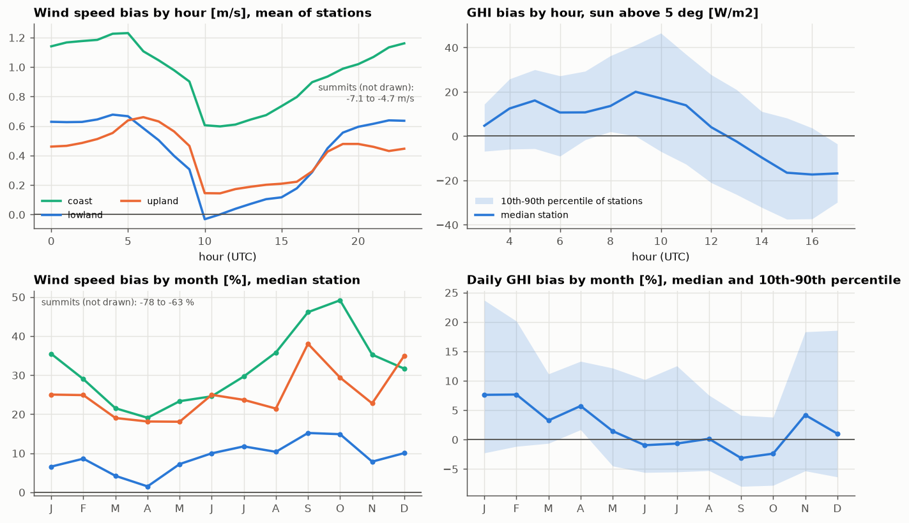
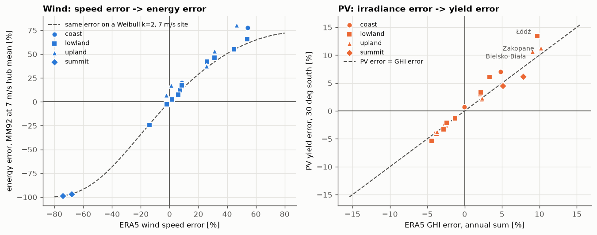
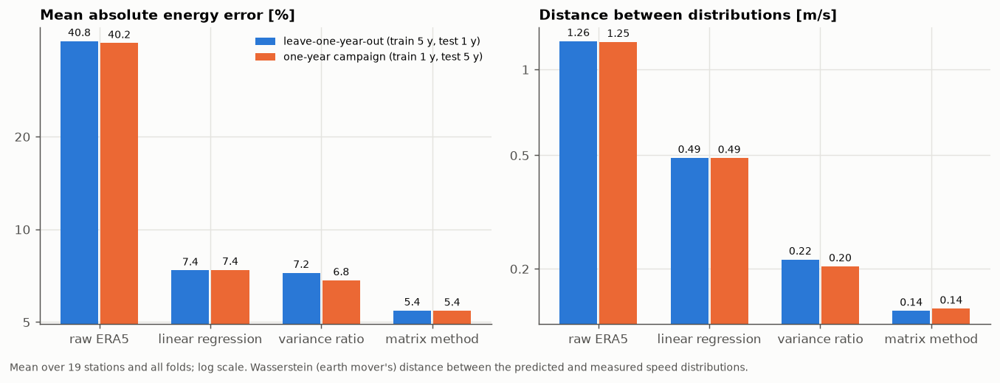
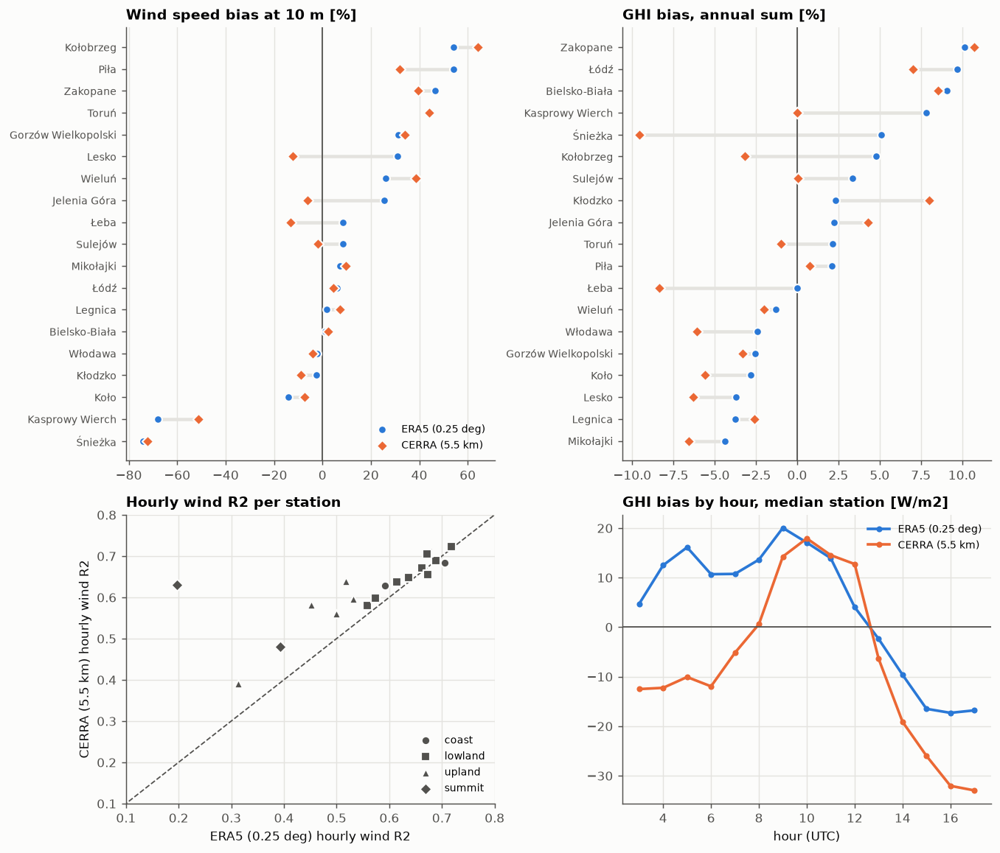
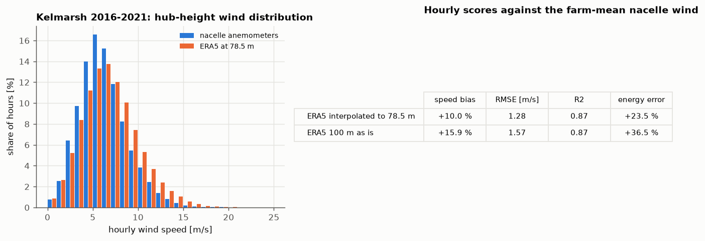
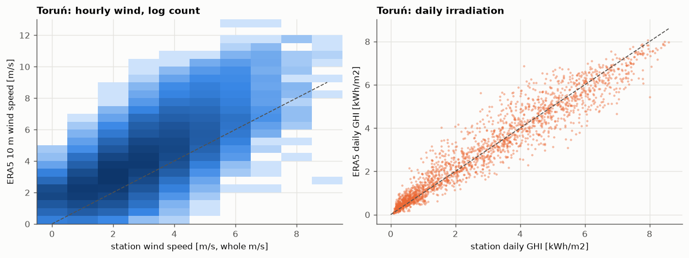

# How good is ERA5 in Poland? Reanalysis wind and sunshine checked against IMGW-PIB stations


Energy yield assessments for wind and PV projects lean on reanalysis data: ERA5 fills the years before a met
mast was put up, provides the long-term reference for measure-correlate-predict (MCP), and is often the only
irradiance series for a PV site. Whether that is safe depends on how well ERA5 reproduces the local weather.
This repository checks it on public measurements:

- **19 IMGW-PIB stations** that report both hourly synoptic observations (10 m wind, temperature) and hourly
  **global radiation** (the actinometric network), 2010-2015, from the coast to the Tatra summits,
- **hourly ERA5** at each station point (Open-Meteo archive API), and for comparison **CERRA**, the 5.5 km
  Copernicus regional reanalysis for Europe,
- **error scores** per station, by hour of day and by month, against terrain and distance to the sea,
- the **energy impact**: wind speed error through a Senvion MM92 power curve, irradiance error through a pvlib
  PV model,
- **long-term correction (MCP)**: linear regression, variance ratio and the matrix method, validated by leaving
  one year out, and
- an optional **hub-height check**: ERA5 at 78.5 m against the nacelle anemometers of the open Kelmarsh wind farm
  data set.

Interactive dashboard (station map, charts per station): **https://kwwaleszczynski-del.github.io/era5-check-pl/**

The project extends a thread from the author's master's thesis, the validation of Copernicus reanalysis against
measurements, and redoes it here on public data only.

## Key results

| | Wind speed at 10 m | Global horizontal irradiance |
|---|---|---|
| Typical bias | median +8 % (17 stations below 1,000 m), range **-14 % to +54 %** at coast and lowland stations, **-74 % / -68 %** on the two summits | median **+2.2 %** of the annual sum, range -4.4 % to +10.2 % |
| Hourly R² (median) | 0.61 (17 stations below 1,000 m) | 0.82 (sun above 5°); daily sums 0.93 |
| Energy impact | median elasticity 1.5: +10 % speed is about +15 % energy at a 7 m/s hub mean | PV yield error 1.1 times the GHI error; up to +13 % |
| Best long-term correction | matrix method: mean absolute energy error **5.4 %** (raw ERA5 40.8 %) | - |
| CERRA instead of ERA5 | median absolute bias 9.6 % instead of 14.1 %, higher R² at 15 of 19 stations | median absolute bias 5.6 % instead of 3.4 %, winter irradiance 19-23 % too low |

- **The 10 m wind bias belongs to the station, not to the region.** Neighbouring lowland stations range from
  -14 % (Koło, open site) to +54 % (Piła). There is no significant rank correlation with elevation
  (Spearman $`\rho = -0.23`$, p = 0.37) or with distance to the sea ($`\rho = -0.31`$, p = 0.22) among the 17 stations
  below 1,000 m: anemometer exposure (shelter, roughness of the surroundings) dominates. On the summits of Śnieżka
  and Kasprowy Wierch ERA5 sees a smoothed mountain and misses three quarters of the wind.
- **ERA5 is too windy at night.** At lowland stations the bias is +0.6 m/s between 19 and 05 UTC and close to zero
  at midday: the reanalysis mixes the stable night-time boundary layer too much. ERA5 distributions are also
  narrower (Weibull shape k of 1.9-2.4 against 1.5-2.3 at the stations), so a correct mean speed can still give a
  wrong energy: Bielsko-Biała has +1 % speed bias but +17 % energy error.
- **ERA5 irradiance is good on average but too bright in winter and in polluted or mountain valleys.** The median
  daily GHI bias is +7.6 % in January and February and -1 % in summer. The largest annual errors are Zakopane
  (+10.2 %), Łódź (+9.7 %) and Bielsko-Biała (+9.1 %), places with winter smog, fog or valley cloud that ERA5's
  aerosol climatology does not see. Because winter irradiance gains most from a tilted plane, the PV yield error
  is larger than the GHI error there (Łódź +13.4 %).
- **MCP removes most of the bias, and the method matters.** Linear regression shrinks the spread of the predicted
  speeds (distance to the measured distribution 0.49 m/s), the variance ratio keeps it (0.22 m/s), the matrix
  method reproduces the conditional distribution (0.14 m/s) and gives the smallest energy error at 15 of 19
  stations. The remaining 5 % comes mostly from changes at the stations: at Toruń the raw ERA5 bias grows from
  +37 % in 2010 to +56 % in 2015, at Piła from +46 % to +66 %.
- **A finer regional reanalysis helps the wind, not the sun.** CERRA (5.5 km) correlates better with the station
  wind at 15 of 19 stations and follows Kasprowy Wierch far better (R² 0.63 instead of 0.20, bias -51 % instead of
  -68 %), but its median absolute wind bias is still 9.6 %: a 5.5 km grid does not see an anemometer's shelter
  either. For irradiance
  CERRA is worse than ERA5, mostly because it is far too dark in winter (median -19 % in January, -23 % in
  December).
- **At hub height ERA5 overestimates too.** At Kelmarsh (flat English Midlands) ERA5 interpolated to 78.5 m is
  10 % faster than the nacelle anemometers (R² 0.87) and would overstate energy by 24 %; taking the 100 m value
  as it is would overstate it by 37 %.

| Station | Terrain | Elevation | To the sea | Wind: station / ERA5 mean | Wind bias | Wind R² | Wind energy error | GHI bias (annual) | GHI R² (daily) | PV yield error |
|---|---|---|---|---|---|---|---|---|---|---|
| Łeba | coast | 2 m | 0 km | 4.8 / 5.2 m/s | +8 % | 0.71 | +20 % | 0.0 % | 0.93 | +0.7 % |
| Kołobrzeg * | coast | 3 m | 0 km | 2.7 / 4.2 m/s | +54 % | 0.59 | +77 % | +4.8 % | 0.93 | +7.0 % |
| Piła | lowland | 72 m | 135 km | 2.4 / 3.7 m/s | +54 % | 0.56 | +66 % | +2.1 % | 0.93 | +3.0 % |
| Gorzów Wielkopolski | lowland | 71 m | 143 km | 2.7 / 3.5 m/s | +31 % | 0.61 | +46 % | -2.6 % | 0.93 | -2.7 % |
| Toruń | lowland | 69 m | 148 km | 2.5 / 3.6 m/s | +45 % | 0.57 | +55 % | +2.2 % | 0.92 | +3.3 % |
| Mikołajki | lowland | 127 m | 148 km | 3.4 / 3.7 m/s | +7 % | 0.64 | +12 % | -4.4 % | 0.93 | -5.3 % |
| Koło | lowland | 115 m | 240 km | 4.3 / 3.7 m/s | -14 % | 0.69 | -24 % | -2.8 % | 0.93 | -3.3 % |
| Łódź | lowland | 175 m | 294 km | 3.5 / 3.7 m/s | +6 % | 0.66 | +7 % | +9.7 % | 0.93 | +13.4 % |
| Legnica | lowland | 122 m | 328 km | 3.3 / 3.4 m/s | +2 % | 0.68 | +2 % | -3.8 % | 0.93 | -4.1 % |
| Sulejów | lowland | 188 m | 338 km | 3.5 / 3.7 m/s | +8 % | 0.67 | +17 % | +3.4 % | 0.93 | +6.1 % |
| Jelenia Góra | upland | 342 m | 350 km | 2.5 / 3.2 m/s | +26 % | 0.53 | +38 % | +2.2 % | 0.91 | +2.1 % |
| Wieluń | lowland | 199 m | 350 km | 2.9 / 3.7 m/s | +26 % | 0.67 | +42 % | -1.3 % | 0.93 | -1.4 % |
| Śnieżka | summit | 1603 m | 367 km | 10.8 / 2.8 m/s | -74 % | 0.39 | -99 % | +5.1 % | 0.78 | +4.5 % |
| Kłodzko | upland | 356 m | 418 km | 3.0 / 2.9 m/s | -2 % | 0.52 | +7 % | +2.3 % | 0.91 | +2.3 % |
| Włodawa | lowland | 177 m | 419 km | 3.7 / 3.6 m/s | -2 % | 0.72 | -3 % | -2.4 % | 0.93 | -2.1 % |
| Bielsko-Biała | upland | 398 m | 505 km | 2.8 / 2.8 m/s | +1 % | 0.45 | +17 % | +9.1 % | 0.86 | +10.7 % |
| Zakopane | upland | 855 m | 567 km | 1.4 / 2.1 m/s | +47 % | 0.31 | +81 % | +10.2 % | 0.83 | +11.2 % |
| Kasprowy Wierch | summit | 1991 m | 574 km | 6.4 / 2.1 m/s | -68 % | 0.20 | -97 % | +7.8 % | 0.72 | +6.2 % |
| Lesko | upland | 420 m | 585 km | 2.4 / 3.2 m/s | +31 % | 0.50 | +53 % | -3.7 % | 0.91 | -3.7 % |

\* Kołobrzeg reported synoptic observations only in daytime until 2015, so its wind scores cover day hours.
Wind energy error: MM92 power curve, both series scaled so that the measured mean is 7 m/s (see
[Method](#method)). All numbers are in `results/*.csv`.

### Where ERA5 is too high and too low





### Daily and seasonal cycle



The hourly GHI bias swings from about +15 W/m² in the morning to -17 W/m² in the late afternoon. This is the
signature of a timing difference of about a quarter of an hour between the two series: shifting the station
records against ERA5 gives the best correlation at 15 minutes for 13 of the 19 stations (`results/timing.csv`).
It cancels in daily sums; the analysis keeps the documented IMGW time convention and does not tune it.

### What the errors do to energy



The dashed curve is the energy error that a pure scaling of the wind speed would cause on a Weibull k = 2 site
with a 7 m/s mean. The upland stations above it (Zakopane, Bielsko-Biała, Kłodzko) add a shape error: their ERA5
distribution is narrower than the measured one (Weibull k 2.0-2.3 against 1.5-1.8).

### Long-term correction (MCP)



| Method (leave-one-year-out) | Mean absolute energy error | Median | Station-years within ±5 % | Mean speed error | Distance to measured distribution |
|---|---|---|---|---|---|
| raw ERA5 | 40.8 % | 36.5 % | 11 % | 27.3 % | 1.26 m/s |
| linear regression | 7.4 % | 5.8 % | 40 % | 3.7 % | 0.49 m/s |
| variance ratio | 7.2 % | 5.7 % | 46 % | 4.0 % | 0.22 m/s |
| matrix method | **5.4 %** | **4.6 %** | **54 %** | 3.4 % | **0.14 m/s** |

114 folds: 19 stations by 6 held-out years. A one-year campaign (train on one year, predict the other five) gives
almost the same ranking: 7.4 / 6.8 / 5.4 % (`results/mcp_summary.csv`).

### ERA5 against CERRA



| Station median (17 below 1,000 m for wind, 19 for GHI) | ERA5 (0.25°) | CERRA (5.5 km) |
|---|---|---|
| Wind speed bias / absolute bias | +8.5 % / 14.1 % | +4.6 % / 9.6 % |
| Wind speed bias range, coast and lowland | -14 % to +54 % | -13 % to +44 % |
| Wind speed bias, Śnieżka / Kasprowy Wierch | -74 % / -68 % | -72 % / -51 % |
| Hourly wind R² | 0.61 | 0.64 |
| Absolute wind energy error | 24 % | 18 % |
| GHI annual bias / absolute bias | +2.2 % / 3.4 % | -2.0 % / 5.6 % |
| GHI annual bias range | -4.4 % to +10.2 % | -9.6 % to +10.7 % |
| Daily GHI bias, January / December | +7.6 % / +1.0 % | -19.2 % / -23.4 % |
| GHI R², hourly / daily | 0.82 / 0.93 | 0.81 / 0.93 |
| Absolute PV yield error | 3.7 % | 6.0 % |

CERRA's radiation is too low in the morning and the late afternoon and slightly high around noon, so it loses
most in winter, when the whole day is low sun. Both reanalyses use the same pairing, sample and energy models.

### Hub height: Kelmarsh



### One station up close



## Data

| Source | What | Period | Licence |
|---|---|---|---|
| [IMGW-PIB public data](https://danepubliczne.imgw.pl), `dane_meteorologiczne/terminowe/synop` | hourly synoptic reports: 10 m wind speed (10-minute mean, whole m/s), direction, air temperature | 2010-2015 | public data, attribution required |
| IMGW-PIB public data, `dane_aktynometryczne` (verified records) | hourly global radiation [J/cm²], true solar time | 2010-2015 | public data, attribution required |
| [ERA5 via Open-Meteo](https://open-meteo.com/en/docs/historical-weather-api) | hourly 10 m wind speed and direction, shortwave radiation (mean of the preceding hour) at the station point (nearest 0.25° cell) | 2010-2015 | CC BY 4.0 |
| CERRA via Open-Meteo | hourly 10 m wind speed and shortwave radiation, same conventions, nearest 5.5 km cell; available on Open-Meteo until 30 June 2021 | 2010-2015 | CC BY 4.0 |
| [Kelmarsh wind farm data](https://doi.org/10.5281/zenodo.16807551), optional | 10-minute SCADA of six Senvion MM92 turbines; also the source of the power curve | 2016-2021 | CC BY 4.0 |
| [Natural Earth](https://www.naturalearthdata.com) | Poland outline for the map | - | public domain |

The 19 stations are all the IMGW sites with both a synoptic station and a verified hourly radiation record in
the period. Coordinates and elevations come from IMGW's radiation inventory; the synoptic site is the same within
1 km (Kołobrzeg's synoptic station moved 13 km west only in 2018). Download sizes: 37.5 MB of synoptic files and
11.2 MB of radiation files; the reanalysis requests weigh about 2,100 Open-Meteo calls in total (ERA5 1,500,
CERRA 600). Everything is cached
in `data/`, which is not part of the repository.

## Method

**Pairing and time.** Synoptic wind is a 10-minute mean ending at the full UTC hour; reanalysis wind is
instantaneous at the hour, so both are compared at the same stamp, and reanalysis radiation (mean of the preceding
hour) is moved to the start of its hour. Radiation records are hourly sums in true solar time, stamped at
the end of the hour; each solar hour is moved to UTC with the station longitude $`\lambda`$ and the equation of
time $`E`$ (Spencer, 1971) and its energy is split over the two UTC hours it overlaps:

```math
t_\mathrm{UTC} = t_\mathrm{TST} - \frac{\lambda}{15^\circ}\,\mathrm{h} - \frac{E(d)}{60\,\mathrm{min}}\,\mathrm{h}
```

Radiation values above the BSRN "physically possible" limit $`1.5\,S_0 \cos^{1.2} z + 100\ \mathrm{W/m^2}`$, or
zero with the sun more than 10° up (recorder outages), are dropped.

**Scores**, as in the validation chapter of the thesis, with $`m`$ the reanalysis and $`o`$ the measurement:

```math
\mathrm{bias} = \frac{1}{n}\sum_{i=1}^{n}(m_i - o_i), \qquad
\mathrm{RMSE} = \sqrt{\frac{1}{n}\sum_{i=1}^{n}(m_i - o_i)^2}, \qquad
R^2 = \operatorname{corr}(o, m)^2
```

Relative bias is the bias divided by the measured mean. Hourly GHI uses hours with the sun above 5°; daily GHI
uses complete UTC days.

**Wind energy.** A 10 m station is not a hub, so both series are multiplied by the same factor
$`k = 7\ \mathrm{m/s} / \bar{o}`$, which puts the measured resource at a typical Polish hub-height mean and keeps
the relative speed error and the shapes of both distributions. The capacity factor follows from the empirical
Senvion MM92 curve (mean of the six Kelmarsh turbines in 2017, IEC method of bins, built in
[wind-power-curve-kelmarsh](https://github.com/kwwaleszczynski-del/wind-power-curve-kelmarsh)); ERA5 is rounded to
whole m/s first, like the synoptic report, so both sides carry the same quantisation:

```math
\Delta E = \frac{\overline{P(k\,\mathrm{round}(m))}}{\overline{P(k\,o)}} - 1
```

**PV energy.** Hourly GHI, Erbs decomposition, Perez transposition to a 30° south plane, physical incidence angle
modifier, SAPM cell temperature, PVWatts DC (-0.35 %/K, 8 % DC losses) and inverter (DC/AC 1.2). The measured
and the ERA5 GHI run through the same chain with the same measured temperature and wind, so the yield difference
is due to irradiance alone. Annual sums use complete days only.

**MCP.** Reference $`x`$: ERA5 wind speed at the station; target $`y`$: measured speed.

- linear regression: $`\hat{y} = a + b\,x`$ by least squares;
- variance ratio:

```math
\hat{y} = \bar{y} + \frac{\sigma_y}{\sigma_x}\,(x - \bar{x})
```

- matrix method: the empirical distribution $`F_c`$ of the measured speed in each cell $`c`$ of reference speed
  (1 m/s bins) and ERA5 direction (12 sectors), at least 10 samples per cell, otherwise the speed bin over all
  sectors, then the variance ratio. The predicted distribution mixes the cells by how often the test-period
  reference visits them ($`N_c`$ of $`N`$ hours):

```math
\hat{F}(v) = \frac{1}{N}\sum_{c} N_c\,F_c(v)
```

Each method is fitted on the training years and judged on the held-out year by the energy error (same $`k`$ as
above, predictions rounded to whole m/s) and by the Wasserstein distance between the predicted and the measured
speed distributions, $`W_1 = \int |\hat{F}(v) - F(v)|\,\mathrm{d}v`$.

**Hub height (Kelmarsh).** Farm mean of the four 78.5 m hub turbines (mean of the two nacelle anemometers, at
least three turbines and five 10-minute records per hour) against ERA5 interpolated from 10 and 100 m with the
hourly shear exponent $`\alpha = \ln(v_{100}/v_{10}) / \ln 10`$.

## Limitations

- **10 m is not hub height.** The station comparison measures how ERA5 represents the wind where IMGW measures it,
  including the anemometer's surroundings. The hub-height scaling turns that into an energy error for
  illustration; it does not model shear. The Kelmarsh check is a single flat site in England, and nacelle
  anemometers read the wind behind the rotor.
- **Whole m/s.** Synoptic wind speed is reported in whole m/s; RMSE includes about 0.3 m/s of rounding noise, and
  energy comparisons round ERA5 in the same way.
- **2010-2015.** The verified hourly radiation archive ends in 2015 (2014 for Łódź, mid-2015 for Bielsko-Biała,
  2012-2014 only for Śnieżka); later radiation is minute data in another format. The synoptic period was matched to
  it, so the wind results describe the same years.
- **Station changes.** The year-to-year drift of the ERA5/station ratio at some stations (Toruń, Piła, Lesko) points
  to changes in exposure or instruments. They are part of the MCP error here, as they would be for a real mast.
- **Timing.** The radiation records and ERA5 agree best with a 15-minute offset (see above); hourly GHI scores
  carry that, daily and annual sums do not.
- **ERA5-Land is not in the comparison.** For wind and radiation ERA5-Land carries the ERA5 atmospheric forcing
  interpolated to 0.1° (Muñoz-Sabater et al., 2021), so comparing it would add little; the Open-Meteo archive
  serves ERA5-Land only for temperature, humidity, snow and soil variables anyway. CERRA, a reanalysis with its own
  5.5 km model and data assimilation, is the higher-resolution comparison instead.
- **CERRA as delivered.** The CERRA series come from Open-Meteo's hourly archive; how much of the low-sun
  radiation deficit is CERRA itself and how much the conversion of its forecast fields to hourly values was not
  separated here. Daily sums are the safer comparison.
- **Not fully independent.** Both reanalyses assimilate synoptic reports (CERRA more of them than ERA5), so the
  station data are not a perfectly independent check.
- **Nearest cell.** ERA5 is taken at the nearest 0.25° grid cell, without interpolation or elevation correction.
- **Not a yield assessment.** The PV and wind models are deliberately simple and identical on both sides; they
  show how a weather error propagates, not what a real plant would produce.

## Reproduce

```bash
python -m venv .venv
.venv/Scripts/python -m pip install -e ".[dev]"      # Linux/macOS: .venv/bin/python
python -m era5_check fetch        # IMGW files (49 MB), ERA5 and CERRA point series (about 2,100 Open-Meteo calls)
python -m era5_check validate     # results/*.csv, about 2 minutes
python -m era5_check report       # docs/img/*.png, docs/index.html, results/summary.json
pytest -q                         # offline tests on synthetic data
```

The hub-height check needs the Kelmarsh Parquet cache built by
[wind-power-curve-kelmarsh](https://github.com/kwwaleszczynski-del/wind-power-curve-kelmarsh); point
`KELMARSH_DATA_DIR` at its `data` folder (default: `../wind-power-curve-kelmarsh/data`). Without it the step is
skipped. Open-Meteo requests are logged in `data/openmeteo/openmeteo_ledger.json` and refused above
`--max-weight` calls per 24 hours (default 2,000; the first full download needs `--max-weight 2200`), because
the free tier limit is shared per IP address.

```
src/era5_check/
  imgw.py        IMGW download (cached) and parsers: synoptic CSV, radiation DAN files, solar time to UTC
  openmeteo.py   ERA5 / CERRA point series with cache, request ledger, pacing, wait-for-reset on HTTP 429
  stations.py    station table, distance to the Baltic coast
  dataset.py     paired hourly frames per station, radiation quality control
  metrics.py     bias, RMSE, MAE, R², Weibull fit
  energy.py      MM92 power curve, hub scaling, pvlib PV chain
  mcp.py         linear regression, variance ratio, matrix method, folds and evaluation
  validate.py    per-station tables
  kelmarsh.py    hub-height check
  plots.py, dashboard.py, pipeline.py, cli.py
```

## Sources and attribution

- **IMGW-PIB.** Źródłem pochodzenia danych jest Instytut Meteorologii i Gospodarki Wodnej – Państwowy Instytut
  Badawczy. The data were processed: quality control, conversion from true solar time to UTC, pairing with ERA5
  and aggregation. Data from https://danepubliczne.imgw.pl, downloaded 21 October 2026.
- **ERA5.** Hersbach, H. et al. (2023): ERA5 hourly data on single levels from 1940 to present. Copernicus Climate
  Change Service (C3S) Climate Data Store, doi:10.24381/cds.adbb2d47. Accessed through the Open-Meteo Historical
  Weather API (Zippenfenig, P., Open-Meteo.com, doi:10.5281/zenodo.7970649), CC BY 4.0. Generated using Copernicus
  Climate Change Service information 2026; contains modified Copernicus Climate Change Service information.
  Neither the European Commission nor ECMWF is responsible for any use that may be made of the Copernicus
  information or data it contains.
- **CERRA.** Schimanke, S. et al. (2021): CERRA sub-daily regional reanalysis data for Europe on single levels from
  1984 to present. Copernicus Climate Change Service (C3S) Climate Data Store, doi:10.24381/cds.622a565a. Accessed
  through the Open-Meteo Historical Weather API, CC BY 4.0. Contains modified Copernicus Climate Change Service
  information; neither the European Commission nor ECMWF is responsible for any use that may be made of the
  Copernicus information or data it contains.
- **Kelmarsh.** Plumley, C., Takeuchi, R.: Kelmarsh wind farm data, Cubico Sustainable Investments,
  doi:10.5281/zenodo.16807551, CC BY 4.0.
- Muñoz-Sabater, J. et al. (2021): ERA5-Land: a state-of-the-art global reanalysis dataset for land applications.
  Earth System Science Data 13, 4349-4383.
- Long, C. N., Shi, Y. (2008): An automated quality assessment and control algorithm for surface radiation
  measurements. The Open Atmospheric Science Journal 2, 23-37 (BSRN limits).
- Spencer, J. W. (1971): Fourier series representation of the position of the sun. Search 2(5), 172.
- Holmgren, W. F., Hansen, C. W., Mikofski, M. A. (2018): pvlib python. Journal of Open Source Software 3(29), 884.
- Map outline: Natural Earth.

## License

MIT for the code (see [LICENSE](LICENSE)). The data keep their own terms listed above.
